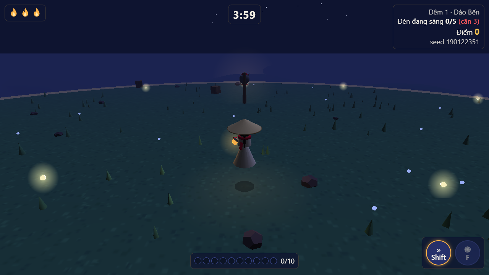

# Đảo Đèn Lồng

> **Video demo:** [docs/demo/demo.mp4](docs/demo/demo.mp4) · **Bản phát hành:** [GitHub Release v1.0.0](../../releases/tag/v1.0.0) · **Lab:** Day 12 AI SDLC · Hoàng Hải Long · 2A202603670
>
> _Trạng thái: file video và Release v1.0.0 chưa có tại thời điểm viết. Chi tiết và việc còn lại: [docs/proof/phase-4/README.md](docs/proof/phase-4/README.md)._



Game 3D góc nhìn thứ ba. Mây, người giữ đèn đội nón lá, gom đom đóm để nạp dầu và thắp các Đèn Lồng Lớn trên **3 hòn đảo trong 3 Đêm** (Đảo Bến, Đảo Cau, Đảo Chuông). Giữ đèn còn sáng tới bình minh, đồng thời né Bóng Mực tím đen (chúng hút dầu từ đèn yếu) và Gió Lạc hay cướp đom đóm.

- Luật chơi viết **một lần** bằng Python thuần ([game/sim.py](game/sim.py), bản đồ ở [game/maps.py](game/maps.py)). Chế độ headless chạy thẳng các file này.
- Bản chơi 3D chạy trên trình duyệt (Three.js). Trình duyệt chạy **chính file Python đó** qua Pyodide, nên chơi và headless ra cùng kết quả (đã kiểm chứng ở Đêm 1, Đêm 3 và kịch bản có nhiên liệu, xem [docs/proof/phase-3](docs/proof/phase-3/README.md)).

## Yêu cầu hệ thống

- **Python 3.9+**. Không cần cài thư viện nào (chỉ thư viện chuẩn).
- **Trình duyệt** để chơi: Chrome, Edge hoặc Chromium mới.
- **Chế độ bench** cần Chrome, Edge hoặc Chromium (xem mục Benchmark). Soak và headless không cần trình duyệt.
- **Internet** lần chạy đầu để tải three.js và Pyodide từ CDN. Không cần Internet nếu chạy `python3 tools/fetch_vendor.py` một lần hoặc dùng file zip Release (chạy offline).
- Số đo hiệu năng trong repo lấy trên Windows 11, AMD Radeon (đồ họa tích hợp), Chrome 157. Máy khác sẽ cho số khác.

## Cài đặt và chạy (macOS / Linux / Windows)

```bash
git clone <repo-url>
cd K5-L3A-DAY12-HoangHaiLong-2A202603670-AI-SDLC-Dao-Den-Long
python3 serve.py          # mở http://127.0.0.1:8000/web/ (thêm ?hq để bật khử răng cưa)
```

Trên Windows, nếu không có lệnh `python3` thì dùng `python`. Menu chính → giới thiệu Đêm → chơi → kết quả → Đêm kế tiếp. Thắng Đêm 3 thì hiện màn Bình Minh với tổng điểm. Thua thì chơi lại Đêm đó.

## Điều khiển

| Phím | Việc |
|---|---|
| `W A S D` | Đi lại (theo hướng camera) |
| Kéo chuột / phím mũi tên | Xoay camera (lăn chuột: thu phóng) |
| `Space` | Nhảy |
| `Shift` | Lướt (2.8 m trong 12 tick, hồi 90 tick) |
| `E` | Nạp đom đóm vào đèn chưa sáng, hoặc châm dầu cho đèn đang sáng (đứng trong 2 m) |
| `F` | Tỏa Sáng: choáng Bóng Mực trong 5 m (tốn 3 đom đóm, hồi 180 tick) |
| `Esc` / `P` | Tạm dừng (Tiếp tục / Chơi lại Đêm / Cài đặt / Về menu) |
| `F3` | Hiện FPS |
| `Enter` | Bắt đầu / xác nhận |

**Đổi phím:** vào **Cài đặt → Phím điều khiển**, bấm tên hành động rồi nhấn phím mới. Phím đã dùng sẽ báo trùng và giữ phím cũ. `Esc`, `Enter`, mũi tên và `F3` là phím dành riêng, không gán được. Nút **Khôi phục mặc định** đưa về phím gốc. Phím đổi được lưu lại sau khi tải lại trang.

## Luật chơi (tóm tắt Ticket-03)

Chi tiết: [docs/notes/phase-3.md](docs/notes/phase-3.md) · quyết định: [ADR-001](docs/notes/adr-001-lantern-fuel.md).

- **Máu** = 3 Ngọn Lửa, hồi đầy mỗi Đêm. Bóng Mực chạm thì mất 1 lửa, rơi một nửa đom đóm đang mang (nhặt lại được), rồi bất tử 1.5 s. Rơi khỏi đảo: mất 1 lửa và toàn bộ đom đóm, hồi sinh ở điểm xuất phát.
- **Đom đóm**: chạm (≤ 1 m) là nhặt. Mang tối đa 10, tăng 2 mỗi lần thắp thành công trong Đêm (tối đa 20).
- **Đèn có dầu**: tối đa 100, hao 1 mỗi giây. Thắp mới cần 10 đom đóm, thắp lại cần 5. Hết dầu thì đèn tắt. Đèn từ 30 dầu trở lên mới có vùng an toàn 6 m; dưới 30 thì nhấp nháy.
- **Bóng Mực** đuổi khi Mây trong 12 m. Khi rảnh, đi tới đèn yếu gần nhất và hút 5 dầu mỗi giây. **Gió Lạc** (Đêm 2–3) cướp 3 đom đóm khi Mây mang ≥ 5. **Bùa Gió** tăng tốc và cho Lướt không hồi chiêu trong 10 s. Đêm 3 có gió mạnh (lá bay báo trước).
- **Thắng** một Đêm khi trời sáng (Đêm dài 240 / 270 / 300 s), còn Mây và đủ 60% số đèn đang sáng (Đêm 1: 3/5, Đêm 2: 4/6, Đêm 3: 5/7). Thắp hết đèn **không** kết thúc Đêm. **Thua**: hết lửa, hoặc trời sáng mà thiếu đèn.
- **Điểm**: nạp mỗi đom đóm +5, thắp lần đầu +100, thắp lại +40, mỗi Bóng Mực trúng Tỏa Sáng +5 (+15 nếu đang hút dầu). Khi thắng: mỗi đèn sáng +50 + dầu còn lại, mỗi lửa còn lại +50. Tổng điểm = tổng các Đêm đã thắng.

## Bảng xếp hạng

- Từ menu chính chọn **Bảng xếp hạng**.
- Sau màn Bình Minh (thắng Đêm 3), hoặc sau khi thua ở bất kỳ Đêm nào, nhập tên để lưu điểm. Tên 3–12 ký tự, chữ không dấu, số và `_`. Tên có dấu tiếng Việt cũng được.
- Giữ top 10, xếp theo điểm giảm dần; bằng điểm thì ai đạt trước đứng trên.
- File lưu: `~/.dao-den-long/leaderboard.json`. Đổi nơi lưu bằng biến môi trường `DDL_LEADERBOARD`.
- Xuất ra file JSON:

```bash
python3 serve.py --export-leaderboard out.json     # ghi {"entries": [...]} theo đúng thứ tự, rồi thoát
```

## Dễ tiếp cận

Trong **Cài đặt**:

- **Phím điều khiển** có thể đổi (xem trên).
- **Phụ đề và chỉ báo hình ảnh** (bật/tắt): Bóng Mực xuất hiện (kèm mũi tên ở mép màn hình chỉ hướng), gió sắp thổi, 10 s cuối, đèn có dầu < 30.
- **Giảm chuyển động**: tắt rung camera và chớp màn hình.
- **Chữ lớn (×1,25)**: mọi chữ UI tối thiểu 18 px ở 1280×720 (22.5 px khi bật chữ lớn).
- **Bảng màu dễ phân biệt** (mù màu): viền và mắt Bóng Mực xanh dương, cảnh báo trắng kèm ⚠, đèn tắt bị xẹp và có vết rách.

Các cài đặt được lưu trên trình duyệt (localStorage).

## Kiểm chứng và test

```bash
python3 tools/check.py          # 223 unit test + 35 kịch bản headless, mỗi kịch bản chạy 2 lần và phải giống hệt từng byte
```

Kiểm tra trình duyệt bằng Playwright (chỉ cho nhà phát triển, không cần để chơi):

```bash
pip install playwright && python3 -m playwright install chromium
PHASE=phase-4 python3 tools/web_check.py
```

CI ([.github/workflows/ci.yml](.github/workflows/ci.yml)) chạy `tools/check.py` mỗi lần push.

## Headless (Test Contract v1.3)

```bash
python3 headless.py --seed 1 --night 1 --ticks 600 --out out.jsonl
```

- `--night` nhận 1, 2, 3. `--scenario` và `--inputs` nhận file JSON. Thêm `--snapshot-every N` để ghi snapshot thưa hơn.
- Khai báo đầy đủ trong [game.contract.json](game.contract.json) (`contract_version: "1.3"`). Phần `tuning` được một test so khớp với số trong code.
- Mã thoát: `0` chạy xong, `2` file sai định dạng, `1` lỗi khác (in ra stderr).
- Một Đêm 3 đầy đủ chạy trong vài giây.

## Benchmark (đo FPS trên máy của bạn)

```bash
python3 bench.py --seed 42 --duration 30 --out bench.json [--browser PATH] [--port P]
```

- Mở trình duyệt ở cửa sổ 1280×720, cảnh chuẩn (200 Bóng Mực, 100 đom đóm, đèn L1–L3 sáng, camera bay vòng tròn). Bỏ 3 s khởi động, đo đúng `--duration` giây, rồi tự thoát.
- Trình duyệt được tìm theo thứ tự: `--browser`, biến `BENCH_BROWSER`, Chrome/Edge/Chromium chuẩn, rồi Chromium của Playwright. Chạy với cờ `--disable-gpu-vsync --disable-frame-rate-limit`, nên `vsync_off: true`. Nếu không tìm thấy trình duyệt nào, bench mở trình duyệt mặc định và ghi `vsync_off: false`, vì khi đó không điều khiển được cửa sổ và vsync.
- `peak_mem_mb` là `null` có chủ ý: trang web chạy trong trình duyệt, JavaScript trên trang không đọc được RSS (bộ nhớ tiến trình) của trình duyệt, nên không có số đo đáng tin. Soak mới là bài đo RSS (xem dưới).
- Output `bench.json` mẫu (máy phát triển, không phải máy chấm): `avg_fps 618.4`, `p1_low_fps 157.2`, `frame_ms_p95 5.6`, `frames 18551`, `load_ms 2463`. Chi tiết: [docs/proof/phase-4](docs/proof/phase-4/README.md).
- Máy chấm của giảng viên sẽ cho số khác. Ngưỡng: `avg_fps ≥ 60`, `p1_low_fps ≥ 30`, `load_ms ≤ 10000`.

## Soak test (10 Đêm liên tiếp, headless)

```bash
python3 soak.py --seed 7 --nights 10 --out soak.json
```

- Chạy 10 Đêm trong cùng một tiến trình (Đêm 1 → 2 → 3 xoay vòng), seed của Đêm thứ i là `7 + i`, input ngẫu nhiên theo seed. Không cần trình duyệt.
- Kết quả mẫu: `crashes 0`, `mem_start_mb 20.4`, `mem_end_mb 20.4` (ngưỡng ≤ 1.2 × đầu = 24.5), 2.0 s. Các kết quả đều là `lost` vì input ngẫu nhiên, nên soak không kiểm tra đường thắng.

## Đóng gói và chạy offline (Release)

- **File zip Release**: `dao-den-long-v1.0.0.zip` chứa `web/` kèm thư viện đã tải (three.js và Pyodide trong `web/vendor/`), `game/`, `serve.py`, `headless.py`, `bench.py`, `soak.py`, và tài liệu. Giải nén rồi chạy `python3 serve.py`, không cần Internet.
- Tự build: `python3 tools/fetch_vendor.py` (tải `web/vendor/`), rồi `python3 tools/make_release.py` (tạo `dist/dao-den-long-v1.0.0.zip`).
- Bản một file cho Artifact: `python3 tools/build_web.py`.

## Tài liệu và bằng chứng

- [CHANGELOG.md](CHANGELOG.md): đổi phá vỡ theo từng phase (Phase 1 đến v1.0.0).
- [Retro 4 phase](docs/notes/retro.md) · [Nhật ký dùng AI](docs/notes/ai-log.md) · [Tiêu chí nghiệm thu Phase 4](docs/notes/phase-4.md) · [Thiết kế Phase 4](docs/notes/phase-4-design.md).
- Bằng chứng từng phase: [phase-1](docs/proof/phase-1/README.md), [phase-2](docs/proof/phase-2/README.md), [phase-3](docs/proof/phase-3/README.md), [phase-4](docs/proof/phase-4/README.md) (bench, soak, ảnh chụp).
- [CREDITS.md](CREDITS.md) (tài nguyên và công cụ) · [LICENSE](LICENSE).

## Harness AI

- [AGENTS.md](AGENTS.md) (CLAUDE.md trỏ tới): lệnh, cấu trúc, quy tắc cho agent.
- Subagent trong [.claude/agents/](.claude/agents/): `coder`, `tester`, `reviewer` (Sonnet), `docs-writer` (Haiku).
- Hook `Stop` trong [.claude/settings.json](.claude/settings.json): chạy `tools/check.py`. Nếu còn đỏ thì agent không được kết thúc.
- Skill [.claude/skills/verify](.claude/skills/verify/SKILL.md): quy trình kiểm chứng và lưu bằng chứng cho mỗi phase.
- CI: [.github/workflows/ci.yml](.github/workflows/ci.yml).
- Phase 4 không có subagent review riêng; kiểm tra độc lập là `tester` viết test hộp đen từ ticket (xem [nhật ký AI](docs/notes/ai-log.md)).

## Sáng tạo của tôi

Chỉ có trong phần hiển thị ([web/index.html](web/index.html)), không đụng tới luật chơi nên không đổi đầu ra headless (headless không chạy file này; `tools/check.py` vẫn đạt toàn bộ). Các mục từ Phase 1 vẫn giữ:

1. **Sương đen lùi dần**: mỗi đèn thắp làm sương mỏng đi (ánh sáng nền theo số đèn đang sáng).
2. **Âm thanh tự tổng hợp** bằng WebAudio, không dùng file asset: tiếng "ting" cao dần theo số đom đóm đang mang, nhạc nền khác nhau mỗi Đêm.
3. **Đèn hiện tiến độ**: đèn chưa thắp sáng dần theo số đom đóm đã nạp. Đèn đã thắp có vòng sáng cho thấy vùng an toàn 6 m.

Thêm ở Phase 2: lời Ông Đăng ở màn giới thiệu và kết quả, lá bay báo gió, đom đóm rơi nhấp nháy trước khi biến mất. Thêm ở Phase 3: thanh dầu trên đèn, Bóng Mực hút dầu có tia nối tới đèn, và chế độ mù màu. Phase 4 thêm bảng xếp hạng, phụ đề và chỉ báo hình ảnh, và chữ lớn.

## Cấu trúc

```
game/sim.py          luật chơi (dùng chung)      headless.py   CLI Test Contract
game/maps.py         bản đồ 3 Đêm               game/leaderboard.py, benchstats.py, procmem.py
web/index.html       bản chơi 3D                 serve.py      mở game, bảng xếp hạng, xuất
bench.py, soak.py    đo hiệu năng, soak          tools/        check, web_check, fetch_vendor, make_release
tests/               unit test + scenarios       docs/notes/   ADR, giả định, retro, nhật ký AI
docs/proof/          bằng chứng từng phase       docs/lab/     tài liệu gốc của lab
CHANGELOG.md         đổi phá vỡ theo phase
```
